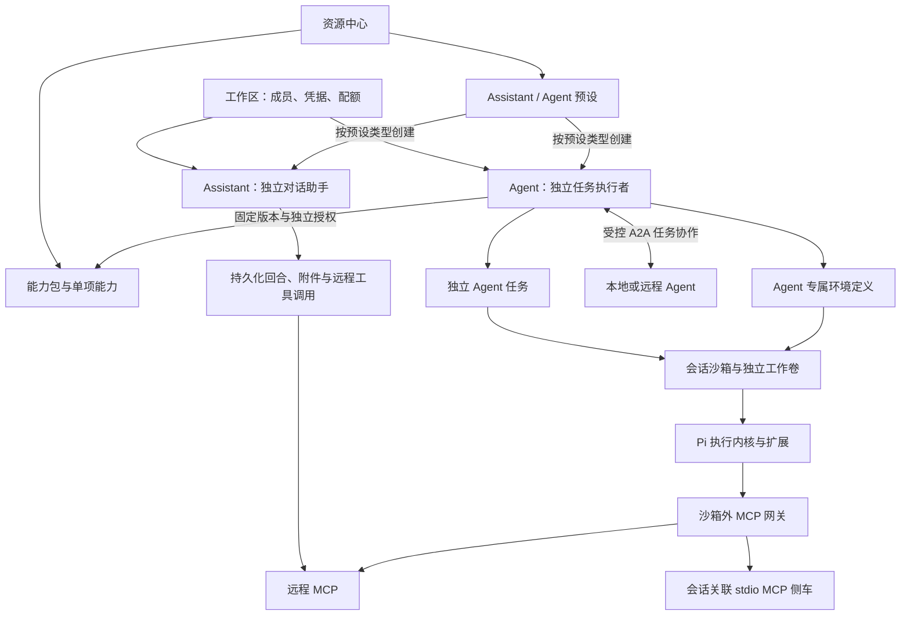
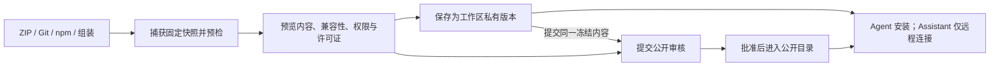

# ToolPlane 新概念与目标架构：Assistant 与 Agent 双产品能力平台

> 状态：设计提案（修订版），供产品与工程评审；不是当前实现说明，也不表示已经批准实施。
> 读者：产品设计、交互设计、平台与运行时开发者。
> 范围：从目标体验重新定义概念，不受现有表结构、接口、菜单和历史实现约束；不讨论迁移与兼容旧入口。

### 本次修订

| # | 问题 | 修改位置 |
|---|---|---|
| 1 | Assistant 对话永久固定旧修订，无法获得修复 | §7.1、§7.4（新增显式升级对话）、§9.5、§13 |
| 2 | 固定模型被供应方下线后无处理策略 | §7.5（新增） |
| 3 | 等待确认无时限、无通知、长期占用资源 | §5.5（新增）、§3.5、§10.2 |
| 4 | Assistant 附件解析方式与安全边界未定义 | §1.2、§5.6（新增） |
| 5 | 排除纯说明型 Skill 的代价未说明 | §1.2 |
| 6 | 创建 Assistant / Agent 用的“模板”与其他“模板”用词混淆 | 全文：创建用的模板改称“预设 Preset”；§3.1 |
| 7 | 各处状态集合不一致 | §5.3、§9.6 |
| 8 | 兼容矩阵与版本冲突规则措辞矛盾 | §3.4、§4.5 |
| 9 | 只限制 MCP 新增工具，未覆盖已有工具变化 | §6.2 |
| 10 | Pi 沙箱与 MCP 凭据之间的信任边界不明确 | §6.3、§11.1 |
| 11 | 缺少共享访问、费用归属、保留期限与分期 | §3.6、§10.3、§10.4、§14（均新增） |
| 12 | 兼容 OMP、DSH 生态：本期只做包级兼容，预留多运行时接口 | §1.2、§2、§3.1、§4.3、§4.7（新增）、§5.1、§8.2、§8.4、§10.2、§13、§14 |
| 13 | 删除 Prompt 模板功能（Pi `prompts`，及 OMP、DSH 包中可能存在的同类内容）：Assistant 与 Agent 都不支持，包内文件只原样保留 | §1.1、§1.2、§2、§3.1–§3.4、§4.2–§4.7、§5.4、§7、§8、§9、§10、§12–§15 |

## 1. 产品目标

ToolPlane 同时提供独立的 Assistant 对话助手与 Agent 任务执行者。两者各自拥有模型、提示词、会话和能力授权，共用资源中心、能力包、远程 MCP 接入与安全基础设施。两者都支持离开网页后继续执行和重新进入恢复；Assistant 不调用或委派 Agent，Agent 之间通过受控 A2A 协作。

用户只需要回答三个问题：

1. **这次是与 Assistant 交流，还是让 Agent 执行任务？**
2. **给它哪些能力和权限？**
3. **何时应用能力更新？**

普通使用流程不要求用户理解工作区安装记录、MCP 网关、插件捕获、运行时授予或会话快照。这些边界依然存在，但由平台管理，而不是变成多个需要手动串联的产品入口。

### 1.1 目标体验

- 创建 Agent 后即拥有专属环境配置，首次使用自动准备沙箱。
- Assistant 配置收敛为模型、系统提示词和远程 MCP；不支持 Skill，不安装 Pi 能力包，不要求 Agent 或沙箱。
- 从资源中心给 Agent 添加 Skill、MCP 或能力包；给 Assistant 配置远程 MCP。
- 需要认证、执行代码或扩大权限时，在同一流程中完成配置与确认。
- Agent 的能力可以组装成 Pi 兼容包；Assistant 可导出助手预设，不提供 Pi 包安装与部分启用流程。
- 更新有明确差异与影响范围，不破坏进行中的会话；已有对话可由用户显式升级到新配置。
- Assistant 对话与 Agent 任务由服务端持有，关闭网页或网络断开不会取消执行；再次打开能看到已保存的结果或接续当前进度；需要用户处理时主动通知。
- 发布者可以通过 ZIP、GitHub/Git、npm 导入来源，先私有使用，再选择公开发布。

### 1.2 明确不做的事情

- 不合并 Assistant 与 Agent 的身份、配置或会话；不把共用底层组件误认为必须共用执行生命周期。
- 不保留 Toolkit 与 Pi 包两套平行的组合、安装和更新体系。
- 不要求单个 Skill 或 MCP 必须先组成一个包才能使用。
- 不为 Assistant 模拟完整沙箱或 Pi 扩展运行时。Assistant 使用有界的对话与工具调用循环。
- 本期 Agent 只有 Pi 一个执行内核。OMP（oh-my-pi）、DSH（DeepSeek Harness）只在包层面兼容：能导入、标注、导出，但不作为 Agent 的执行内核。环境定义与运行时适配接口按多运行时预留（§4.7），以后增加运行时不需要改动数据模型。
- Assistant 不支持 stdio MCP、执行脚本、终端或本地工程，也不提供“交给 Agent 执行”、自动降级或隐式转交功能。需要这些能力时用户独立进入 Agent 发起新任务。
- 不支持 Prompt 模板：Pi 的 `prompts`，以及 OMP、DSH 包中可能存在的同类内容，都不解析、不展开、不注册为 `/` 命令，Assistant 与 Agent 都不提供。包里的这类文件只作为原样保留的内容，保证导出的包在原生 Pi 中不变（§4.6）。
- 不自创通用插件语言、深层包嵌套系统或另一套依赖管理器。
- 不把市场审核、文件校验和或权限声明当作执行安全的充分保证。

#### 有意接受的取舍

以下是为保持 Assistant 轻量而主动放弃的能力，评审时应按产品取舍而非遗漏处理：

- **Assistant 不做代码式数据分析。** 附件只经过受控解析转为文本、表格摘要或图像输入（§5.6），不运行代码统计、绘图或转换文件。需要对 CSV、表格做计算的用户使用 Agent。这使 Assistant 在数据分析场景弱于提供代码解释器的同类产品。
- **Assistant 失去 Skill 的按需加载。** Skill 的价值在于参考资料只在相关时进入上下文（渐进加载）。大型方法文档放在 Assistant 中只能写进系统提示词或作为附件整体送入，上下文成本更高。接受这一代价，以换取不在 Assistant 中维护 Skill 发现、加载与脚本边界。
- **没有可复用的输入快捷方式。** 删除 Prompt 模板后，用户不能用 `/名称` 调出预先写好的一段输入。常驻的要求写进系统提示词；不同用途的要求放在不同的 Assistant；Agent 的可复用方法用 Skill。接受这一代价，以换取不维护模板的解析与展开语义、与扩展命令的冲突规则，以及跨 Pi / OMP / DSH 的格式差异。

## 2. 核心决策

| 决策 | 规定 | 解决的问题 |
|---|---|---|
| 两种独立产品 | Assistant 负责对话与有界工具调用；Agent 负责有工作环境的任务执行 | 保留不同使用方式、成本与生命周期 |
| 独立配置、共用基础设施 | 两者分别拥有模型、提示词、修订和能力授权，共用制品与工具接入 | 避免配置耦合，不重复建设分发和安全模块 |
| 网页不是执行宿主 | Assistant 回合和 Agent 任务均由服务端持久化执行，浏览器只提交、订阅和显示 | 断线不丢进度，重连不重复执行 |
| 不提供 Assistant 委派 | Assistant 不调用 Agent，不参与 A2A | 产品边界不依赖隐式能力升级 |
| MCP 按产品区分 | Assistant 仅远程 MCP；Agent 支持远程与 stdio | 避免为聊天创建本地进程和环境 |
| Skill 与 Pi 包仅供 Agent | Assistant 不加载任何类型的 Skill，也不安装完整或部分 Pi 包 | 取消说明型 / 脚本型分流与混合包兼容规则 |
| Pi 是本期唯一的 Agent 执行内核 | Agent 在隔离环境中运行 Pi；Assistant 不直接执行 Pi 扩展代码；环境定义带运行时字段，本期只接受 Pi | 明确扩展兼容与隔离边界，同时不把 Pi 写死进数据模型 |
| 跨生态只做包级兼容 | 识别 OMP、DSH 的包声明；按运行时记录“已验证”兼容性；导出可同时写多份清单；不依赖社区桥接 | 能复用 OMP / DSH 生态内容，又不承担多套运行时的维护成本 |
| Pi 包只启用三类内容 | extensions、skills、themes 按各自语义解析；`prompts` 声明与文件原样保留，不解析、不注册；界面按目标筛选 | 不为一个输入快捷方式维护解析、展开、冲突与跨生态兼容规则 |
| 包是唯一组合分发单元 | 组装、发布、版本、安装、更新使用同一套包生命周期 | 取消 Toolkit 与插件包的重复职责 |
| 每个 Agent 有专属环境 | 配置归 Agent；每个会话拥有独立可写工作环境 | 同时满足归属明确与并发隔离 |
| 更新生成各自的配置修订 | 每个 Assistant / Agent 独立应用；新会话采用新修订，已有会话保持原修订，可显式升级 | 更新一种产品不悄悄影响另一种，也不把用户困在旧配置 |
| 等待用户有时限 | 所有等待确认/输入的执行都有到期时间、释放策略与通知 | 离线不无限占用资源，不让请求被遗忘 |
| 资源中心是目录和管理界面 | 不拥有执行状态，不构成额外资源绑定层 | 降低用户需要理解的层级 |

## 3. 概念词典与关系

### 3.1 用户需要理解的概念

| 概念 | 定义 | 不是什么 |
|---|---|---|
| 工作区 Workspace | 人员、资源、凭据和配额的归属与权限边界 | 不是某个 Agent 的可写工作目录 |
| Agent | 能执行任务的配置化主体，有身份、模型、提示词、能力与环境 | 不是一个市场包，也不是某个正在运行的进程 |
| Assistant | 独立的对话助手，有自己的模型、提示词、能力和对话历史 | 不是 Agent 的皮肤，也不默认拥有专属可写环境 |
| 对话 Conversation / 回合 Run | Assistant 的历史、当前配置修订，以及服务端持久化的一次生成与工具执行 | 不依赖浏览器连接，不是 Agent 沙箱任务 |
| 执行会话 Session | Agent 的持续任务上下文，保存消息、执行记录、配置修订与工作文件 | 不只是聊天消息数组，也不复用 Assistant 对话身份 |
| Skill | 以 `SKILL.md` 为入口的任务方法、参考资料、脚本和附件 | 不是工具连接，不自动取得权限 |
| MCP | 通过 MCP 协议提供工具的服务；需要连接或部署后使用 | 不是模型，也不是任务规划器 |
| Pi 扩展 Extension | 由 Pi 加载的可执行扩展代码 | 不等于整个 Pi 包，也不是普通 Skill |
| 扩展命令 Extension Command | Pi 扩展通过 `pi.registerCommand()` 注册的 `/命令`，调用时执行扩展代码 | 属于 Pi 扩展，只在 Agent 沙箱中可用；Assistant 没有任何 `/` 命令 |
| A2A 协作 | Agent 之间通过任务、消息与产物进行协作的协议边界 | 不是 MCP 工具协议，不是 Assistant 转交功能 |
| 能力包 Package | 一组可分发、可版本化的能力与配置要求，兼容 Pi 包结构 | 不是正在运行的 Agent，也不包含真实凭据 |
| 运行时 Runtime | Agent 执行内核及其版本，如 `pi@x.y`；兼容性按运行时分别记录 | 本期只有 Pi 可选；OMP、DSH 是兼容性标注的对象，不是可选内核 |
| Assistant / Agent 预设 Preset | 分别创建两种产品的默认配置，包含相应能力版本及兼容要求 | 不包含历史会话、工作卷、凭据或已有资源授权 |
| 待处理事项 Pending Action | 执行中需要用户确认、输入或认证的请求，有到期时间与通知 | 不是默认同意，也不是永久挂起的执行 |
| 资源中心 Resource Center | 发现、导入、管理、发布和更新上述可分发资源的界面 | 不运行模型，也不是另一层能力容器 |

**术语约定：** 用于创建 Assistant 或 Agent 的默认配置一律称“预设”，不称“模板”。界面、API 与文档遵循同一用词。

**`/` 命令只来自 Pi 扩展。** 原生 Pi 中 `/名称` 有两种来源：扩展命令（执行代码）和 Prompt 模板（文本展开）。ToolPlane 只保留前者：Agent 中的 `/命令` 由 Pi 扩展注册或由 Pi 自带；包里的 `prompts` 不注册，不会出现在命令列表中（§4.6）。Assistant 没有 `/` 命令，以 `/` 开头的输入按普通文本发送。

**Toolkit 不再作为独立概念。** “把若干能力放在一起”就是组装能力包；“供外部客户端接入”是该包或所选能力的连接功能，不创建另一个可以独立编辑、发布的 Toolkit 对象。

### 3.2 关系图



### 3.3 独立对象，而不是一对一绑定

- Assistant 与 Agent 都可单独创建、使用、分享和删除；创建其中一个不隐式创建另一个。
- 两者可以选用不同模型、提示词、能力和权限；配置不同是产品能力，不是需要同步消除的“漂移”。
- 复用的是模型接入、远程 MCP 连接、授权、审计与界面组件，不是可互相修改的配置记录；Skill 加载和 Pi 包管理仅属于 Agent。
- Assistant 对话固定属于一个 Assistant，Agent 执行会话固定属于一个 Agent；不能通过切换页面或改绑 ID 转换归属。
- Assistant 不调用 Agent，也没有 Agent 允许列表、任务委派或上下文转交。用户可以独立打开 Agent 创建新任务，平台不自动携带 Assistant 对话或文件。
- 复制配置或从预设创建会生成独立对象，后续编辑不自动双向同步。界面没有隐式的“转换为 Agent”；需要时显式创建新对象并重新配置与授权。
- 删除 Assistant 按其对话与回合的保留、停止策略处理，不影响独立 Agent；删除 Agent 按其任务、A2A 引用与工作卷策略处理，不删除 Assistant 对话。
- 公共链接、API、消息渠道明确指向 Assistant 或 Agent，分别进入相应生命周期，但使用同一套身份和权限校验。

### 3.4 能力兼容矩阵

| 能力 / 行为 | Assistant | Agent |
|---|---|---|
| 独立模型、系统提示词、历史记录 | 支持 | 支持 |
| Skill（包括纯说明型） | 不支持，不安装、不加载 | 支持；脚本在沙箱与批准范围内执行 |
| 对话附件 | 支持，经隔离解析后作为用户输入（§5.6），不作为 Skill 加载，不做代码分析 | 支持，按任务文件权限使用 |
| 远程 MCP | 支持，连接与工具范围单独授权 | 支持，连接与工具范围单独授权 |
| stdio MCP | 不支持，不代为启动或透明代理 stdio 配方 | 支持受控进程 / 侧车 |
| Prompt 模板（Pi `prompts` 等） | 不支持 | 不支持；包内文件原样保留，不注册（§4.6） |
| Pi 能力包 | 不安装，也不能从包中导入任何内容 | 支持安装、组装和更新 |
| Pi 可执行扩展 | 不支持 | 在声明的 Pi / 平台兼容范围内支持 |
| Pi 主题 / 终端交互组件 | 不改变 Web UI，不承诺可用 | 取决于实际交互模式，浏览器不自动支持终端 UI |
| 关闭网页、断线后恢复 | 支持，回合继续执行，重连回放或接续进度 | 支持，任务继续执行，恢复状态与产物 |
| 需要用户处理时通知 | 支持（§5.5） | 支持（§5.5） |
| 已有对话 / 会话升级到新配置 | 支持，用户显式操作（§7.4） | 不支持原地升级，使用新会话（§7.3） |
| 持续工作目录与终端 | 不提供 | 支持，按执行会话隔离 |
| A2A 调用与被调用 | 不支持 | 支持，显式配置协作关系与权限 |
| 调用工具产生外部写入 | 可以，但需要权限和风险确认 | 同样需要权限和风险确认 |

Assistant 不是“只读 Agent”，也不是绑定网页连接的临时请求。它可以通过远程 MCP 写入外部系统，并在网页断开后完成当前有界回合；区别是不提供本地代码执行、持续工作环境或 Agent 任务协作。服务端持续执行和沙箱是两件不同的事。

Assistant 不按“说明型 / 脚本型”筛选 Skill，而是完全不提供 Skill 加载机制。附件是用户提交的对话输入，不自动发现参考目录、不运行脚本，不以改名方式重新引入 Skill。

Pi 包仅安装到 Agent。Assistant 不从包中导入任何内容；其远程 MCP 始终单独配置和授权。

### 3.5 A2A：仅 Agent 之间的任务协作

取消的是 Assistant → Agent 委派，不是 Agent 之间的 A2A。Assistant 不暴露 A2A 端点、没有 A2A 连接配置，也不提供本地 Agent 调用工具。Agent 可以直接接受用户任务，也可以在批准范围内调用本地或远程 Agent。

**MCP 用于调用工具，A2A 用于与另一个有独立身份、执行状态和结果产物的 Agent 协作。** A2A Agent Card 中的 `skills` 是服务能力描述，不等于 ToolPlane 的 `SKILL.md` 资源，不自动安装包或授予权限。

#### 连接、发现与授权

- Agent 有入站开放与出站协作两项独立设置，默认关闭；出站允许列表按目标身份、能力范围、次数、费用、时限和数据范围配置。配置批准范围内可自动调用，超范围等待有权用户确认。
- 同工作区 Agent 使用受控本地路由，远程 Agent 使用明确登记的 A2A 端点。两者采用相同的任务授权语义，不因为走本地就绕过权限校验；跨工作区不自动互信。
- 读取 Agent Card 以发现协议版本、能力、认证要求、传输与交互能力。固定并校验支持的协议版本与能力；不兼容明确报错，不把任意 HTTP 聊天 API 宣称为 A2A。
- Agent Card 与远程返回内容都是不可信数据，不包含凭据、私密配置或内部容器地址。端点和产物 URL 的访问受 SSRF、DNS、重定向、大小与格式限制。
- 入站请求验证调用主体、目标 Agent 和工作区授权；会话 Cookie 不作为外部 A2A 身份。出站使用独立的受限凭据或短期工作负载身份，不把用户账户级 Token 放入沙箱或传给被调用方。
- 有效权限取目标自身策略、调用者获准范围、本次任务限制与当前平台策略的交集。不自动传播父 Agent 的工具授权、秘密或系统提示词；远程服务的内部隔离无法由本平台证明，传出数据需按信任范围批准。

#### 任务、上下文与产物

1. 调用方提交选定任务与必要消息、附件引用，平台记录来源任务、目标身份、幂等键、预算与授权；本地目标固定配置修订，远程目标记录可观察的 Card / 版本身份，不假装能锁定对方实现。
2. 目标返回独立任务身份与上下文身份。它们绑定调用主体、工作区和目标 Agent；仅知道 ID 不能读取、继续或取消任务。新协作上下文拥有独立工作卷，不共享父会话可写目录。
3. 状态与结果使用目标协议的实际语义，包括处理中、需要输入/认证、完成、失败、取消或拒绝；平台保留原始状态并按 §9.6 统一状态映射 UI，不把不同状态都归为“成功返回”。
4. 输入不足时暂停并生成待处理事项，向发起任务的用户请求必要确认或资料（时限与通知见 §5.5）；模型不能自动批准认证或扩大权限。确认后继续同一授权上下文，新的独立工作创建新任务。入站任务需要输入时，向调用方返回协议规定的“需要输入”状态，由调用方负责其用户交互，本平台不直接联系对方用户。
5. 产物以有来源身份、内容类型、摘要和范围受限访问权的引用交付。按策略复制获准文件，不挂载对方卷；Agent 输出按数据处理，不能作为平台系统指令执行。

#### 恢复、取消与循环控制

- 流式订阅只是观察任务。断线后使用任务身份查询状态或按协议重新订阅；本地保留规范化事件和游标，不要求远端实现同一种事件日志。
- 请求超时不等于远端执行失败。先查询、对账；无法确认是否已提交的请求标为“状态未知”，不盲目重发有副作用任务。仅在远端明确支持幂等时依赖其幂等保证。
- 取消父任务时对本次创建且由父任务拥有的活动子任务发起取消；不取消共享或既存上下文中的其他任务。对方拒绝或无法确认时显示“取消待确认 / 远端可能继续”，不保证事务性撤销。
- 记录调用链、祖先任务与深度，拒绝已知循环；对不受控远端不能仅依赖其转发链路信息，仍限制平台出站次数、深度、总预算、并发和超时。
- 包和 Agent 预设只能声明 A2A 需求，不能携带已授权的工作区目标 ID 或凭据。消费者安装后重新映射目标并授权；Assistant 预设没有此配置。
- 跨工作区调用的费用归属见 §10.3。

### 3.6 访问与共享

Assistant / Agent 的配置权限与其对话 / 任务的访问权限分开管理。

| 权限 | 含义 | 默认 |
|---|---|---|
| 管理 | 编辑配置、应用更新、管理连接授权、删除对象 | 创建者与工作区管理员 |
| 使用 | 用该对象发起自己的对话或任务 | 对象创建者；可分享给成员、群组或整个工作区 |
| 查看他人对话 / 任务 | 读取消息、工具记录与产物 | 仅发起者；管理员按审计策略访问并留痕 |
| 继续 / 停止 / 处理待处理事项 | 向他人对话或任务提交新输入、批准确认或停止执行 | 仅发起者；任务可显式添加协作者 |

- 对话和任务默认归发起者私有。获得“使用”权限不等于能看到他人的历史。
- 发起者可以把单个对话或任务分享为只读，或添加可操作的协作者；协作者批准的确认以协作者身份审计。
- 工具调用使用的凭据身份由连接决定（工作区共享连接或个人连接）。使用他人共享的 Assistant 时，个人连接需要使用者自己授权，不借用对象创建者的个人凭据。
- 管理员停止他人的执行需要独立的权限并留下审计记录；停止不授予读取内容的权限。
- 对象删除、成员离开工作区或分享撤销后，相关访问即时失效；离开者发起的进行中执行按工作区策略继续、转移所有者或停止。

## 4. 能力与 Pi 包

### 4.1 三类能力的职责

**Skill：提供 Agent 的任务方法。** Agent 按需加载说明、参考资料和附件，在沙箱中运行获准脚本。Assistant 不支持任何 Skill，包括纯文本 Skill。安装 Skill 不会自动授予网络、文件或 MCP 权限。

**MCP：提供可以调用的工具。** 能力定义包含协议、配置要求和工具说明；实际使用依赖目标工作区中的连接、凭据和授权。

**Pi 扩展：改变运行行为。** 可以增加 Pi 支持的命令、事件处理或工具。扩展代码只在隔离的执行或构建环境中加载，不在 Web 服务进程中执行。

三者互补。例如：代码审查 Skill 定义审查步骤，GitHub MCP 提供 PR 读写工具，Pi 扩展提供专用审查命令。

### 4.2 包与扩展不是同义词

一个能力包可以包含：

- 零个或多个 Pi 扩展；
- 零个或多个 Skill；
- Pi 原生主题等资源（包中可以有 `prompts` 声明，但 ToolPlane 不启用，见 §4.6）；
- MCP 需求或可部署配方；
- 兼容性、配置字段、来源与许可证信息。

**只包含 Skill 和 MCP 的包也是合法包，不要求为了打包而编写一个空扩展。**

单独添加 Skill 或 MCP 时，平台使用相同的版本制品、来源和权限记录，但界面仍显示“Skill”或“MCP”，不制造额外可见的包层级。

### 4.3 原生 Pi 兼容边界

- 以原生 Pi 包声明与目录规范为基础，接受原生扩展、Skills 和主题；`prompts` 原样保留但不启用（§4.6）。
- npm/Git/ZIP 是来源方式，不是三种插件标准。
- ToolPlane 的 MCP 配方、配置输入和平台策略放在独立附加元数据中，不篡改原生 Pi 字段语义。
- MCP 由 ToolPlane 的适配层接入 Pi；不宣称任意原生 Pi 客户端会自动部署这些 MCP。
- 导出提供原生 Pi 制品和必要的平台附加描述，界面说明哪些内容需要 ToolPlane。
- 终端交互扩展、主题、操作系统与原生依赖可能有兼容限制。浏览器不会自动变成 Pi 终端 UI。
- 展示兼容性时，按运行时分别说明已验证版本、运行平台和交互模式（如“已验证 pi@x.y，OMP 未验证”）；不将“可解析”标为“可运行”，也不笼统写“兼容 Pi 生态”。OMP、DSH 的兼容规则见 §4.7。

### 4.4 组装规则：固定、扁平、可解释

用户从 Agent 或工作区资源选取能力，点击“组装为包”。Assistant 页面不提供包组装或安装；其配置通过助手预设分享。

1. 选择要包含的 Skill、扩展与 MCP 需求。
2. Skill 和扩展固定到明确版本或内容摘要。
3. MCP 转换为无密钥的需求定义或便携配方，不导出工作区连接 ID、Token 或实际私网配置值。
4. 明确需要消费者填写的变量、授权范围和运行环境。
5. 预览内容、来源与许可证，生成不可变发布候选制品。

不支持无限嵌套“包内再管理包”。选择已有包参与组装时，解析为扁平能力清单并保留来源；相同内容只加载一次，同一逻辑能力出现不兼容版本时必须由发布者选择，不能最后写入者获胜。组装不生成 `prompts` 声明；参与组装的已有包中的 Prompt 文件不带入新包。

代码依赖使用包自身生态的依赖描述与锁文件，在受控构建环境解析；ToolPlane 记录最终制品，不另外实现 npm 依赖求解器。无可用锁文件的来源必须展示构建可复现性限制。

### 4.5 同名与权限冲突

- 能力用来源身份、资源路径和版本/摘要标识，显示名称不是唯一标识。
- 同一个 Skill 从单独安装和包内同时出现且内容相同，只加载一次，并展示两个来源引用。
- 同一能力的不同版本禁止在同一对象中同时启用；用户必须明确选择其中一个版本，没有覆盖开关。
- 不同 MCP 工具使用连接命名空间；Pi 扩展工具、命令和 Skill 名称冲突时，在应用配置前报错。
- 不自动重命名会被扩展代码引用的原生命令来掩盖冲突。
- 多个来源对同一工具的权限不能无提示取并集。形成最终有效权限后展示变化，由有权用户确认。
- 包内 Skill 默认跟随包更新。需要单独编辑时显式“复制为独立 Skill”，保留来源并处理同名冲突，不修改共享制品。

### 4.6 Pi `prompts`：不支持，原样保留

ToolPlane 不支持 Prompt 模板。原生 Pi 包可以声明 `prompts`，例如：

```json
{
  "name": "my-pi-extension-pack",
  "keywords": ["pi-package"],
  "pi": {
    "extensions": ["./src/*.ts"],
    "skills": ["./skills"],
    "prompts": ["./prompts/*.md"],
    "themes": ["./themes/*.json"]
  }
}
```

其中 `extensions`、`skills`、`themes` 按原生语义处理；`keywords` 用于包发现，不替代内容校验或可信证明。对 `prompts` 的处理如下：

- **导入：** `prompts` 声明与其匹配的文件随包一起原样保存在制品中，不解析 frontmatter、不识别参数。捕获时仍执行与其他文件相同的安全检查：在固定包根目录展开声明，不允许 glob、链接或路径逃逸到包外。
- **预览：** 包预览按 Extensions / Skills / Themes 展示可用内容，另起一行说明“包含 N 个 Prompt 模板，ToolPlane 不支持，不会启用”，不逐个列出模板名或命令名。
- **安装到 Agent：** 运行时适配层只向 Pi 注册 extensions、skills、themes；`prompts` 不注册，因此不会出现在命令列表或输入框提示中，也不参与与扩展命令的冲突检查。
- **Assistant：** 不从包中导入任何内容，也没有 `/` 命令。
- **Prompt-only 包：** 没有可启用的内容。可以导入为工作区资源并下载，但不能安装到任何 Assistant 或 Agent；安装入口说明原因。
- **组装：** 新组装的包不生成 `prompts` 声明；参与组装的已有包中的 Prompt 文件不带入新包（§4.4）。
- **导出：** 原样保留发布时的 `pi.prompts` 声明、相对路径与文件，导出的包在原生 Pi 中行为不变；导出页标注这部分内容“在 ToolPlane 中未启用”。
- **OMP、DSH：** 这两个生态的包中若有同类内容，同样不解析、不启用，按上述规则原样保留（§4.7）。

需要可复用的指令时：Assistant 写进系统提示词，或为不同用途建立不同的 Assistant；Agent 写进系统提示词或做成 Skill。代价见 §1.2。

### 4.7 OMP 与 DSH：包级兼容与多运行时预留

**背景。** OMP（oh-my-pi）是 Pi 的分叉，有独立的包声明（`omp.*`，同时接受旧的 `pi.extensions`）和部分 Pi API 兼容层，但并非所有 Pi 扩展都能运行，对插件包内 Skill 的校验也更严格。DSH（DeepSeek Harness）是另一套架构，所有能力都是 Cordis 插件，以 `dsh.bundle` 声明，目前仍是开发者预览；Pi 扩展在 DSH 上只能经社区兼容宿主部分运行。三者在 Skill 与 MCP 上接近，在扩展代码上基本不可互换。

**本期范围（方案 A）：** Agent 仍只在 Pi 上执行。ToolPlane 能导入为 OMP / DSH 编写的包，复用其中可移植的内容；导出的包可以同时给 Pi、OMP、DSH 使用；所有兼容性按运行时分别标注。不在本期运行 OMP 或 DSH，也不在平台核心中依赖 dsh-pi、pi2dsh 等社区桥接——它们本身是部分兼容，又跟随预览版 DSH 变化。

#### 导入时识别的声明

| 声明 | 识别方式 | 本期在 Pi 内核中的结果 |
|---|---|---|
| `pi.*` | 原生（§4.3） | 按原生语义安装 |
| `omp.*` | 按固定的 OMP 版本解析其中的扩展、Skill 等声明 | Skill 与 MCP 需求可用；OMP 扩展列为“仅 OMP，不可在 Pi 中运行”，不加载 |
| 同时存在 `pi.*` 与 `omp.*` | 两份分别解析，不合并 | 使用 `pi.*`；`omp.*` 作为 OMP 兼容声明保留，用于导出 |
| `dsh.bundle` | 按固定的 DSH 版本，只解析其中明确声明的 Skill 目录与 MCP 服务配置 | Skill 与 MCP 需求可用；DSH 插件代码列为“仅 DSH，不可运行”，不加载；无法识别的字段列为不支持 |

- 识别结果在预览页按运行时分列展示，用户能看到哪些内容可用、哪些只是被保留。
- 不可运行的扩展或插件不阻止包内其他内容使用，但包不能被标为“完整安装”。
- 平台不自动改写扩展源码（例如把 `@oh-my-pi/pi-*` 的 import 替换为 `@mariozechner/pi-*`）。改写后的代码不是发布者的制品，运行结果也无法由发布者负责；需要两边运行的发布者自行提供各自的入口。
- OMP、DSH 版本变化快。解析器按固定版本工作，新版本需要更新解析器并重新验证；未知的必需字段明确报不兼容，不猜测语义。

#### 按能力类型的规则

| 能力 | 规则 |
|---|---|
| Skill | 导入时按**三者中最严格的公共规则**校验：必须有 name 与 description、目录名与 name 一致、frontmatter 只使用 Agent Skills 规范字段。不满足时仍可在 Pi 中使用，但标为“仅 Pi”，并指出不满足的规则；导出给 OMP / DSH 时提示可能被拒 |
| MCP | 始终经 ToolPlane 网关接入，与运行时无关。包里的 MCP 需求可跨生态复用；导出时按目标生态生成配置说明，但不保证目标生态客户端的能力（例如 DSH 的 MCP 客户端目前只桥接 Tools，部分版本会丢弃图像与资源内容块） |
| Prompt 模板 | 不支持（§4.6）。`pi.prompts` 原样保留；OMP、DSH 包中若有同类内容，同样原样保留、不解析 |
| Pi 扩展 | 在 Pi 内核中运行。对 OMP / DSH 一律标为“未验证”，除非已有该运行时的验证结果 |
| OMP 扩展、DSH 插件 | 本期只保留、展示，不加载、不可启用 |

#### 兼容性记录

每个发布版本按运行时记录兼容性，而不是一个笼统的“兼容 Pi”标志：

- 运行时标识与版本范围（如 `pi >=x.y`、`omp 18.x`、`dsh 0.2.x`）；
- 每类能力的结果：可运行、仅保留、不兼容、未验证；
- 来源：**平台验证**（在该运行时的隔离环境中加载测试通过）或**发布者声明**（未经平台验证）。两者在界面上分开显示，发布者声明不显示为“已验证”。

本期平台只对 Pi 做验证；OMP、DSH 的兼容性只能是发布者声明或“未验证”，直到平台为该运行时提供验证环境。

#### 导出

- 导出包可以同时包含 `pi.*`、`omp.*` 与 `dsh.bundle` 声明，分别指向各自可用的内容，互不改写字段语义。
- 只有发布者明确提供的声明才会被写入；平台不替发布者生成 OMP 扩展入口或 DSH 插件。
- 导出页列出每个目标生态可用与不可用的内容，与 §8.4 外部客户端规则一致：不声称在目标生态中安装了完整包。

#### 为多运行时（方案 B）预留的接口

本期就按以下方式实现，使以后增加 OMP 或 DSH 内核时只是新增一个实现，而不是推翻模型：

1. **环境定义带运行时字段**（§5.1）：`runtime = {id, version}`。本期 API 只接受 `pi`，其他值明确拒绝。
2. **运行时适配接口。** 控制平面只通过一个内部适配接口与内核交互，Pi 是第一个实现。接口覆盖：加载固定制品、以会话身份向 MCP 网关请求工具、把内核事件映射为 §9.6 的统一状态、检查点与恢复、取消、执行器故障上报。控制平面中不出现 Pi 专有调用。
3. **兼容检查以运行时为键。** 安装、更新、组装时的兼容校验按环境的运行时查表，不在代码中写死 Pi。
4. **与运行时无关的部分保持中立**：MCP 网关、凭据边界（§6.3）、A2A、配额、审计都不依赖内核类型。
5. **切换运行时等同于重新配置**：生成新修订并全量重新校验能力兼容性与授权；已有会话保持原运行时，不原地切换。
6. **依赖解析按运行时生态进行**（例如 OMP 使用 Bun），在受控构建环境中完成，平台只记录最终制品。

以后真正实施方案 B 时还需要：每个运行时的一致性测试与基础镜像、状态映射、跟随上游版本的升级节奏，以及该运行时的验证环境。建议先接入 OMP（与 Pi 同源，差距最小），DSH 待其正式发布后再评估。

## 5. 执行生命周期、沙箱与断线恢复

### 5.1 一个 Agent，一份专属环境定义

Agent 环境定义至少包含：

- 运行时标识与版本（`runtime = {id, version}`，本期固定为 Pi，见 §4.7）、基础镜像和平台；
- 已解析的能力版本与依赖；
- 初始工作文件或基础快照；
- CPU、内存、存储、并发和运行时长限制；
- 网络与文件访问策略；
- 凭据引用，而不是凭据明文。

创建 Agent 时建立专属环境归属；容器按首次使用或明确预热创建，不要求每个闲置 Agent 都常驻进程。

### 5.2 每个会话一个隔离的可写环境

“每个 Agent 有沙箱”不等于所有会话共享一个可写容器。

- 每个会话有独立工作卷和沙箱，读取已固定的 Agent 配置修订。
- 同一会话一次只执行一个回合；后续请求排队或明确拒绝，不并发写入同一运行状态。
- 不同会话可并发，受 Agent 与平台配额共同约束。
- 停止或回收容器不等于删除会话工作卷；恢复使用原卷和原修订。
- 会话之间不自动合并文件。用户可显式复制文件或从某会话创建新的基础快照。
- 有状态的 A2A 协作建立独立执行上下文与工作卷，不继承来源会话的可写目录；同一上下文串行，重复请求不重复创建任务。
- 外部 MCP 服务的数据可能仍然共享；沙箱隔离不代表隔离 GitHub 仓库、数据库等外部副作用。

### 5.3 会话创建与执行

```mermaid
sequenceDiagram
    actor User as 用户
    participant Entry as Agent 界面 / API / 已授权 A2A
    participant Control as 控制平面
    participant Box as 会话沙箱
    participant Pi as Pi 内核
    participant GW as 沙箱外 MCP 网关
    participant MCP as MCP 服务
    User->>Entry: 发起请求
    Entry->>Control: 身份、Agent、会话与消息
    Control->>Control: 校验访问、修订、授权与并发配额
    Control->>Box: 创建或恢复该会话环境
    Box->>Pi: 加载固定制品与会话状态
    Pi->>GW: 以会话身份请求已授权工具
    GW->>MCP: 注入凭据后调用
    MCP-->>GW: 工具结果
    GW-->>Pi: 结果（不含凭据）
    Pi-->>Entry: 流式回复、工具过程与文件变化
    Entry-->>User: 展示结果
```

Agent 沙箱不可用时显示“环境准备中”或明确错误，不切换到没有相同能力的另一执行路径，不静默丢失工具后继续回复。独立 Assistant 的普通对话不依赖该沙箱，仍可继续。Agent 任务同样不绑定浏览器请求，状态与产物由服务端保存，重新进入时恢复观察。

**Agent 执行器或沙箱故障：** 与 Assistant 相同（§5.4），区分浏览器断线与执行器故障。容器崩溃或宿主失联时，任务标为“中断”，保留工作卷、已持久化的消息与工具记录；Pi 会话状态可从工作卷恢复时由用户显式“继续”，否则只能基于现有文件开始新回合。结果未知的副作用工具调用标为“状态未知”，先对账，不自动重放。

### 5.4 Assistant 服务端回合与断线恢复

**关闭网页只断开订阅，不取消回合。** “有界”限制的是单次执行的时间、Token、轮数与工具调用，不是要求用户一直在线。

1. 提交消息时先持久化消息、请求幂等键、对话当前的 Assistant 修订和 Run，再返回稳定的 Run ID；客户端重试同一请求获得同一回合。
2. 运行由服务端执行器持有，独立于 HTTP / SSE 连接和页面生命周期。一个对话同时只运行一个回合，新提交排队或明确拒绝；重复订阅不是新提交。
3. 将消息增量、工具调用状态、确认请求、用量和最终状态写入带单调序号的事件记录及消息快照，持久化后再对外发布。允许批量写入增量，不承诺每个 Token 单独落库。
4. 浏览器断开后执行器继续运行，或进入等待用户状态（§5.5）；没有订阅者不是取消条件。显式停止、达到限额、授权失效、待处理事项到期或执行失败才改变执行状态。
5. 重开页面先加载对话快照、Run 状态与游标，再从游标之后订阅；事件按 Run ID + 序号去重。游标过期则返回新快照与游标，不重新调用模型或工具。
6. 若已完成，直接展示完整持久化回复；仍在执行则补齐缺失内容并继续显示；等待确认则恢复原确认项，离线不等于同意；失败则保留已有内容并说明原因。

模型和远程 MCP 调用由受限执行器完成，不加载 Skill、Pi 包或用户扩展代码。附件处理见 §5.6，不提供 shell 或本地工程目录。

Run 状态见 §9.6。多个页面可以观察同一个 Run，但只有一名有效执行器持有租约；恢复接管用租约代次防止过期执行器继续写入。

**浏览器重连与执行器故障恢复不同。** 执行器重启后从已落盘的安全检查点恢复；若模型供应方不能恢复中断的生成流，标记中断并保留部分回复，由用户明确重试或续写，不声称无损续接模型内部状态。已发出的副作用工具调用先对账；无幂等或查询能力且结果未知时停止重放并提示检查，不自动再次执行。

停止是服务端命令，校验归属与权限后持久化停止请求并中止可取消的模型/工具调用。网页关闭不发送停止；工具已产生的外部副作用不能撤销，不可取消的调用要显示实际状态，不提前宣布停止成功。重新生成是新的 Run，不覆盖原记录或重复应用原回合副作用。

恢复、订阅、确认与停止都重新校验用户、工作区和对话归属（§3.6）。Run ID / 游标不是授权凭据；权限撤销后不能借旧连接继续读取或调用。事件与快照按同一保留策略清理（§10.4），不用消息内容或凭据作为重连 Token。

### 5.5 等待用户：时限、资源释放与通知

Assistant 回合、Agent 任务和 A2A 子任务在需要确认、输入或认证时，都生成一个**待处理事项**，而不是无限期挂起。

**到期与默认结果**

- 每个待处理事项有到期时间。默认值（待评审确认）：Assistant 工具确认 24 小时；Agent 任务确认或输入 72 小时；A2A 子任务继承父任务剩余时限，不超过 72 小时。工作区管理员可在平台上限内调整。
- 到期的默认结果永远是**拒绝**，不是同意：Assistant 回合以“等待超时”结束，保留已生成内容；Agent 任务进入“等待超时”并保留工作卷，用户可之后显式继续或开新回合；A2A 父任务收到子任务“已取消（等待超时）”。
- 用户在到期前处理后继续原执行；到期后才处理，提示已失效，需要重新发起。
- 在等待期间权限被撤销、配置被安全禁用或对象被删除时，待处理事项立即失效，结果同到期。

**等待期间的资源**

- 等待期间不持有模型生成流或执行器租约。执行器持久化检查点后释放租约；用户处理后由任一执行器重新接管。
- 等待中的 Agent 会话沙箱在空闲阈值后休眠，工作卷保留；处理后按需唤醒。
- 等待时间不计入回合的运行时长与 Token 限额，但计入执行的整体存活期限；已消耗的费用照常计量。
- 每个用户和工作区限制同时存在的待处理事项数量；达到上限时新的需要确认的执行在提交前提示，而不是静默排队。

**通知**

- 发起者在线时在当前页面就地显示；不在当前页面时，通过平台内通知中心提示，并按用户设置发送浏览器推送、邮件或已接入的消息渠道。
- 通知只包含对象名称、事项类型与到期时间，以及进入详情的链接；不包含工具参数、消息内容或凭据。打开链接需重新登录与权限校验。
- 到期前按设置发送一次提醒（默认到期前 2 小时）。
- 多个协作者时（§3.6），通知所有有权处理的人；第一个有效处理生效，其他人看到已被谁处理。
- 通知发送失败不影响到期规则，通知中心始终保留待处理列表。

### 5.6 Assistant 附件处理

Assistant 没有沙箱，但附件解析本身是在处理不可信文件，不在对话服务进程中执行。

- 附件上传到受控对象存储后，由独立的**解析工作者**处理：无网络、只读访问该文件、无平台凭据，CPU、内存、时间和输出大小受限，每个文件在一次性隔离环境中处理。
- 支持的类型与结果：纯文本、Markdown、代码文件按原文；PDF、Office 文档提取文本与表格结构；CSV / 表格提取表头、行数与有限行预览；图片直接作为模型图像输入（若所选模型支持）。不支持的类型明确拒绝并说明，不尝试执行或转换。
- 解析结果超过上下文预算时截断并提示用户已截断的部分，不静默丢弃。
- 解析失败、超时或检测到异常结构（压缩炸弹、嵌入可执行内容）时，该附件标为失败，回合继续但告知模型和用户该附件不可用。
- 文件中的指令性文字只作为数据，不能改变系统提示词或授予工具权限。
- 解析结果与原文件一起按对话的保留策略管理（§10.4）。
- 附件不提供计算：Assistant 不对表格做统计、不运行公式、不生成图表文件（见 §1.2 取舍）。

## 6. MCP：定义、连接与使用分开

### 6.1 三个对象，界面只在需要时展示

| 对象 | 含义 | 生命周期 |
|---|---|---|
| MCP 定义 | 如何连接/运行、需要什么配置、提供什么工具 | 跟随发布版本 |
| MCP 连接 | 当前工作区如何满足该定义，包括私密配置引用 | 由工作区管理 |
| 使用授权 | 某个 Assistant 或 Agent 可使用哪个连接、哪些工具与操作范围 | 随各自配置修订，并受实时撤销及任务限制约束 |

能力包声明“需要 GitHub MCP”不等于发布者替消费者创建并授权了 GitHub 连接。安装时可以选择已有连接或创建新连接。

### 6.2 远程 MCP

- 支持 Streamable HTTP 和 SSE；传输形式在定义中明确。
- 默认 HTTPS。允许显式配置 HTTP，但提示明文风险，不自动降级。
- 凭据在工作区加密存储，通过受控连接提供；远程 Token 默认不下发给扩展代码。
- 私网访问受管理员策略、DNS 校验和重定向限制控制。
- Assistant 与 Agent 可以复用同一个连接，但各自拥有独立的工具授权；共享凭据不等于共享对象全部权限。
- 远端实现由服务提供方管理，固定连接配方不能保证远端行为不变。

#### 工具目录变化

授权记录的不只是工具名，还包括每个已批准工具的**描述与输入 / 输出 Schema 摘要**。网关在建立会话和定期刷新时比较远端工具目录：

| 变化 | 处理 |
|---|---|
| 新增工具 | 不暴露给任何对象，直到有权用户批准 |
| 已批准工具的描述变化 | 暂停该工具，展示新旧描述差异，需重新批准；描述是模型会读取的指令性内容，变化可能是工具投毒 |
| 输入 / 输出 Schema 变化 | 暂停该工具，展示差异；仅新增可选字段时可由管理员策略设为“提醒但不暂停” |
| 工具删除或改名 | 视为删除与新增，已有授权失效，不自动映射到新名称 |
| 注解变化（如只读 / 破坏性标记） | 按新的风险标记重新评估；从只读变为写入时必须重新批准 |

- 暂停只影响新的调用；进行中的调用按原状态完成。
- 变化与批准都写入审计，记录前后摘要。
- 暂停的工具在对话和任务中显示为“需要重新批准”，不悄悄从工具列表消失，也不让模型在缺少说明时猜测替代工具。

### 6.3 stdio MCP

- Agent 的 stdio 默认作为执行会话关联的侧车容器运行，与会话共同启停，不在控制平面直接执行命令。
- Assistant 不支持 stdio：导入、安装、更新和执行入口均拒绝为其绑定 stdio 配方，不通过隐藏容器或透明网关绕开限制。
- 固定镜像/制品和启动参数；私密变量按需投递，不通过公开配置或日志泄漏。
- 默认不挂载 Agent 工作卷；确有需求时明确声明并批准挂载路径。
- Agent 本地文件和缓存归执行会话所有，不能因配方相同就共享可写进程。
- 管理员可独立运营共享的远程 MCP 服务；Assistant 只消费已经存在的远程协议端点，不负责其背后的部署、启动或生命周期，也不能引用 Agent 私有 stdio 实例来规避隔离。

#### 沙箱与 MCP 凭据的信任边界

Pi 扩展在会话沙箱内与 Pi 共享安全域（§11.1），因此任何 MCP 凭据都**不能出现在该安全域内**：

- **MCP 网关在沙箱之外。** 沙箱内的 Pi 只持有一个短期会话身份，用它向网关请求已授权的工具调用；网关校验身份、工具授权和目录摘要后注入凭据并转发。沙箱内看不到远程 Token。
- **每个 stdio 侧车是独立容器**，不与沙箱共享进程空间、文件系统（除明确批准的挂载）或环境变量。侧车的私密变量只投递给该侧车。沙箱与侧车之间只通过网关转发的 MCP 消息通信，不直接建立网络连接。
- 侧车之间相互隔离；一个 MCP 的侧车无法读取另一个 MCP 的变量或文件。
- 沙箱的出站网络默认只允许访问网关与已批准地址；网关地址不接受来自沙箱的凭据注入或转发目标修改。
- 会话身份限定在当前会话与已授权工具，有效期短，随会话结束和权限撤销失效；即使被扩展读取，也只能调用该会话本来就获准的工具。

### 6.4 测试成功才称为可用

连接验证包括启动或连通性、MCP 握手、认证和工具发现。它只能证明当时的协议可用性，不能证明所有工具业务操作均成功。

有副作用的工具不会被自动测试调用。界面提供明确的手动调用与确认。

更换凭据或调整共享连接配置时，展示所有受影响的 Assistant 与 Agent；添加一个包不会偷偷修改既有共享连接。需要不同配置时创建新连接。

## 7. 版本与更新：独立配置，共用版本机制

### 7.1 相同机制，不同修订所有者

| 层级 | 保存内容 | 可变性 |
|---|---|---|
| 发布版本 Release | 制品摘要、来源、兼容条件、能力和配置要求 | 不可变，修改需发布新版 |
| Assistant 配置修订 | 模型、系统提示词、远程连接引用与权限 | 不含 Skill 或 Pi 包安装记录，每次应用生成新修订 |
| Agent 配置修订 | 模型、提示词、完整能力、环境、连接引用与批准范围 | 每次应用生成新修订，仅属于该 Agent |
| Assistant 对话 / Run | 当前所用 Assistant 修订、修订升级历史、消息、工具状态、事件游标、附件引用与生成结果 | 修订不自动变化，可由用户显式升级（§7.4）；每个 Run 记录其执行时的修订；断线不取消 |
| Agent 执行会话 | Agent 修订、任务状态、消息、工作卷与执行记录 | 修订不自动变化，工作文件可变化 |

工作区可以缓存制品，但缓存不是用户必须手动推进的一层安装状态。主操作是“应用到选定 Assistant / Agent 的新对话或新任务”，不能把两类对象写入同一可变配置。

配置修订保存凭据引用而非值。凭据轮换可以影响历史对话与任务，这是安全维护，不属于插件热更新；权限撤销和危险版本禁用始终即时生效。

### 7.2 更新过程

1. 展示当前版本、目标版本和发布说明，以及使用它的 Assistant 与 Agent，默认只选择当前对象。
2. 比较文件、扩展、Skill、工具权限、配置字段和环境要求；显示各目标实际启用的内容。
3. Agent 检查包兼容性、冲突、依赖与连接；Assistant 只检查模型与远程连接，不涉及包，也不隐式迁移到 Agent。
4. 在隔离环境准备制品并验证，失败不替换该对象的当前有效修订。
5. 对新增代码执行、敏感权限或共享连接影响取得明确授权。
6. 成功后原子切换该对象的默认修订。已有 Assistant 对话与 Agent 执行会话保持各自原修订；Assistant 对话可按 §7.4 显式升级。

更新默认为手动；不自动合并新增权限。批量更新按对象分别提交和报告，不宣称跨 Assistant / Agent 的全局事务。更新 Agent 不改变任何 Assistant 配置；更新 Assistant 不改变任何 Agent 任务。A2A 已受理任务保留目标修订，新的协作任务重新解析允许使用的目标配置。

编辑和确认携带期望修订；被他人修改时重新比较，不覆盖较新的配置。A2A 创建与恢复均校验目标身份、修订和实时授权，历史上下文不能恢复已失效权限。

### 7.3 回滚与卸载

- 回滚将历史可用配置恢复为新的默认修订，重新校验授权、制品保留和环境兼容性；不原地改写已有修订。
- 回滚不撤销数据库写入、远端评论或工作文件变化，也不复活已撤销凭据与权限。
- Agent 想在新版本继续任务，显式创建新执行会话并选择复制文件，不改写旧记录归属或授权。Agent 会话不支持原地升级，因为工作卷中的文件、Pi 状态与能力版本相互依赖，原地替换能力可能使会话状态不一致。
- 卸载生成不含该能力的新修订；历史对话与任务仍引用的制品保留到引用释放，撤销规则除外。
- 卸载不自动删除共用连接、其他对象能力、A2A 任务或工作卷。
- 安全撤销不同于普通卸载：阻止相关新执行并按策略停止使用危险版本的运行。旧对话可保留可读历史，但不能因此继续调用已撤销能力。

### 7.4 显式升级已有 Assistant 对话

Assistant 对话通常持续很久，用户期望修复后的提示词或新增的工具在原对话中生效。因此 Assistant 对话允许**由用户显式升级**到该 Assistant 的当前默认修订，但不自动发生。

1. 当对话使用的修订不是当前默认修订时，对话顶部显示“此助手已更新”及更新时间，不阻断使用。
2. 用户打开差异：模型、系统提示词、远程 MCP 工具及权限的变化，与 §7.2 的比较使用同一组件。
3. 新修订引入的新工具或扩大的权限，按正常流程由用户确认；用户没有确认的权限不随升级生效。
4. 用户确认后，对话的“当前修订”切换为新修订，并在消息流中插入一条可见的系统标记（“已于某时升级到修订 N”）。之后的 Run 使用新修订；之前的 Run 仍记录并展示其执行时的修订。
5. 升级只在对话没有进行中的 Run 时允许；有进行中或等待用户的 Run 时，提示先等待完成或停止。
6. 升级不重写历史消息、不重新执行旧回合。新模型或新系统提示词读取的仍是原历史消息；若新模型的上下文窗口小于历史长度，提示将按新模型规则截断或摘要，由用户确认。
7. 可以撤销升级：回到对话之前使用的修订（若该修订仍可用、未被安全撤销），同样插入标记。
8. 被安全撤销的修订不能作为升级或撤销目标；由于安全撤销被强制停用的对话，提示用户升级到可用修订或开始新对话。

“新建对话并复制消息/附件”仍可用，适合想保留原对话不变的场景。

### 7.5 固定依赖失效：模型下线

修订固定的模型可能被供应方弃用或下线。这与安全撤销不同：不是平台决定禁用，而是依赖本身不再存在。

- **提前预告：** 模型提供方公布下线日期后，工作区设置中登记该日期。所有固定该模型的 Assistant / Agent 修订、及仍在使用它们的对话和会话，在管理页与对象页显示下线预告和剩余时间；管理员收到通知。
- **替换建议：** 平台为每个将下线的模型给出建议替代模型（由工作区管理员确认），对象管理者一键创建使用替代模型的新修订，其余配置不变，按 §7.2 走更新流程。
- **下线之后：**
  - 对象的默认修订仍是已下线模型时，新对话与新任务被拒绝，提示管理者更新。
  - Assistant 对话：历史可读；继续发送时提示该模型已下线，提供“升级对话”（§7.4，若对象已有新修订）或“新建对话”。
  - Agent 会话：历史与工作卷可读、可下载；新回合被拒绝，提示用新修订创建新会话并复制文件。
  - 进行中或等待用户的执行，在下线时间点按“中断”处理，保留已有内容。
- 平台不在用户不知情的情况下把对话静默切换到其他模型；不同模型的行为、价格与数据处理条款不同，切换必须由有权用户确认。
- 同样的规则适用于其他由外部提供、平台无法保留的固定依赖（如模型提供方的特定 API 版本）；平台可保留的制品（包、镜像）按 §7.3 的引用保留规则处理。

## 8. 资源中心、上传和发布

### 8.1 市场展示什么

默认展示：能力包、Skill、MCP、Assistant 预设、Agent 预设。Pi 扩展是包内内容和可筛选能力，不再增加一套平行安装管理。

Assistant 预设只包含模型要求、系统提示词与远程 MCP 需求；Agent 预设还包括 Skill、能力包、环境、执行要求与 A2A 需求。安装分别创建独立对象，不连接发布者的私有实例。消费者重新绑定连接和 Agent 的 A2A 目标并授权。

资源中心按目标筛选。Pi 包、Skill 的安装目标仅为 Agent；远程 MCP 可分别配置给两者。发布者验证、平台审核、工作区私有信任分别显示。

### 8.2 输入来源

| 来源 | 用户输入 | 平台固定的身份 |
|---|---|---|
| ZIP / 文件夹 | 本地内容，必要时选择根目录 | 内容清单与摘要 |
| GitHub / Git | 仓库、ref、子目录 | 实际 commit 与子目录快照 |
| npm | 包名、版本或 tag | 精确版本、完整性摘要及捕获制品 |
| 工作区资源 / Agent 能力 | 选择要组装的内容 | 能力版本、配置要求与来源记录；Assistant 分享配置使用助手预设 |

ZIP 只是传输格式。根据内容识别 Pi 包（含 `omp.*`、`dsh.bundle` 声明，规则见 §4.7）、Skill 或包含明确元数据的 MCP 配方；无法识别或存在多个根时由用户选择，不能猜测某个脚本就是启动入口。

Git 仓库有多个包或 Skill 时先预览、选择，再导入。私有来源的认证只用于抓取，不进入制品。

### 8.3 发布流程



- 导入、私有使用和公开发布是独立选择；私有使用不要求先公开。
- 执行不可信扩展仍需有权限的用户确认，私有信任不伪装成人工审核。
- ZIP 路径穿越、链接逃逸、压缩炸弹、超额文件和冲突路径在接收边界拒绝。
- 预览与提交固定同一快照；来源变化必须重新预览，不能提交另一份内容。
- 公开版本不可覆盖。新版本审核不替换当前已批准版本，来源更新也不自动发布。
- 私有转公开必须显式确认披露内容；仅批准的版本可公开下载，不能顺带暴露该条目的私有历史版本。
- 包内检查覆盖可分发性与许可证；发现密钥阻止发布。用户仍需明确确认导出文件范围，不能默认打包整个沙箱工作目录。
### 8.4 下载与外部使用

下载和平台安装是两个独立动作：

- Skill：完整 ZIP 为默认；单独 `SKILL.md` 是次级操作。
- Pi 包：提供可被 Pi 使用的包制品，保留原有资源声明（含原样保留、ToolPlane 未启用的 `prompts`）与相对路径，明确实际归档格式。发布者提供了 `omp.*` 或 `dsh.bundle` 声明时一并导出，并按运行时列出可用内容（§4.7）。
- MCP：提供无密钥连接配置样例或运行配方，不将远程服务假装成可下载程序。
- Assistant / Agent 预设：分别导出行为配置、兼容能力与必要的环境要求，不导出消息历史、工作卷、凭据和工作区资源 ID；Agent 的 A2A 关系只能导出为待配置需求。

外部客户端接入选择所需 MCP 与 Skill，并创建范围受限、可撤销的客户端登记；MCP 通过网关，Skill 通过文件同步。登记固定所选版本和授权，不形成另一套可独立发布的组合定义。

不同客户端的可用能力分别展示。不能加载 Pi 扩展的客户端只接收支持的资源；必须在用户确认前说明差异，不声称安装了完整包。

## 9. 界面信息架构

### 9.1 三个主要入口

| 一级入口 | 用户任务 | 子页面 |
|---|---|---|
| Assistants / 对话助手 | 创建助手、聊天、使用远程工具、恢复历史与进行中回复 | 助手列表、对话、能力、模型与系统提示词、分享 |
| Agents / 任务执行者 | 创建执行者、发起任务、管理环境与 A2A 协作 | 概览、任务、能力、环境与文件、协作、模型与设置、分享 |
| 资源中心 | 找能力、导入、组装、发布、更新 | 发现、工作区资源、更新、我的发布 |

全局还有**通知中心**，汇总当前用户的待处理事项（§5.5）、模型下线预告（§7.5）与可用更新；它只是列表与跳转入口，处理动作在对应对话或任务中完成。

两个产品入口平级，Agent 的任务界面本身可对话，不需要先创建 Assistant。Assistant 不显示 Agent 委派入口或关联任务卡片；需要代码执行的用户独立进入 Agent，不自动转交消息或附件。

工作区设置集中管理成员、模型提供方与下线日期、凭据、共享 MCP 连接、配额与保留策略，不是日常添加能力的必经入口。MCP、Skill、包使用筛选和能力分类，不再各建一套平行一级管理入口。

### 9.2 两种对象的“能力”页

复用相同的列表和安装组件，根据目标展示兼容能力与运行要求：

- 名称、类型、来源、固定版本与实际启用内容；
- 当前可用性、待配置字段、有效权限，以及“需要重新批准”的工具（§6.2）；
- Agent 展示直接添加或来自包的能力；Assistant 展示远程连接，不展示包安装状态；
- 双方提供配置、更新、停用、移除；“组装为包”仅在 Agent 与资源中心提供；
- Assistant 不显示 Skill、Pi 包、扩展、stdio、沙箱或终端配置。Agent 的“协作”页单独管理 A2A，不与 MCP 混为一谈。

编辑任一对象只影响自身。共用连接的变更需进入明确的共享配置确认，不在能力列表中隐式修改其他对象。

### 9.3 “添加能力”主流程

1. **选择目标**：从对象页面进入时固定当前 Assistant 或 Agent；资源中心先选目标类型和对象，也可创建对象。
2. **检查类型与兼容性**：Skill 和 Pi 包只能选择 Agent；Assistant 只能添加远程 MCP。
3. **配置能力**：选择 MCP 连接、填写私密字段、确认命名与版本冲突。
4. **确认权限**：说明代码执行、文件访问、网络和工具范围；Assistant 工具同样可能有副作用。
5. **准备与应用**：验证后生成该对象的配置修订；结果写明“用于新对话（已有对话可升级）”或“用于新任务”，提供对应开始按钮。

没有缺失配置或新增风险时合并步骤，不强制点击空白向导页。允许保存未完成草稿，但不能显示为已启用；下载和仅收藏到工作区是次级动作。

### 9.4 分别创建与配置

**创建 Assistant**：填写名称、选择模型与系统提示词，可添加远程 MCP，直接开始聊天。附件作为对话输入。没有 Skill、Pi 包、沙箱、stdio 或委派设置；回复在服务端执行，离开网页后仍可恢复。

**创建 Agent**：填写名称、选择模型与任务提示词，获得 Pi 环境定义；可以添加能力，直接发起任务。CPU、镜像、网络、挂载与并发是高级设置，首次执行按需准备沙箱。不自动创建 Assistant。

预设只预填对应产品配置，消费者重新绑定连接、凭据及 Agent 的 A2A 目标并授权。两者可以复制共同配置字段，但不会形成后续自动同步。

### 9.5 恢复、升级与 A2A 协作界面

**Assistant 对话**：顶部把“连接中 / 离线 / 已连接”与回合状态分开。重开后先显示已保存内容，再补齐新事件；生成中仍有停止按钮，等待确认恢复原确认项并显示剩余时间，已完成不再显示生成动画。中断时保留部分内容，提供明确的重试 / 续写，而不是把重连当作重新生成。

**对话升级**：助手有新修订时，对话顶部显示不打扰的提示条，提供“查看变化”和“升级此对话”。升级后在消息流中显示修订标记；每条回复可查看其生成时的修订。

**待处理事项**：确认卡片显示到期时间与将被拒绝的默认结果；到期后卡片变为“已过期”，不可再批准，提供“重新发起”。

**Agent 协作**：只在 Agent 页面展示入站和出站配置，以及任务链、目标、状态、预算与获准产物。需要输入时定位具体任务，取消时展示每个相关任务的实际结果；不在 Assistant 中建立 Agent 任务面板。

**`/` 输入**：只有 Agent 的输入框提供命令提示，列出 Pi 自带命令和已启用扩展注册的命令，不包含包里的 Prompt 文件。Assistant 没有 `/` 命令，以 `/` 开头的文本按普通消息发送，不获得命令执行能力。

### 9.6 状态用语

各处执行状态使用同一套名称；A2A 远端协议状态映射到 Agent 任务状态，并保留原始值供详情查看。

| 状态维度 | 状态 | 不应混淆的含义 |
|---|---|---|
| 发布 | 私有、待审核、已公开、已撤销 | 不表示已配置或正在运行 |
| 配置 | 草稿、待配置、已应用、依赖即将下线、依赖已下线 | 已应用不保证远程服务始终在线 |
| Assistant 回合 | 排队、生成中、工具调用中、等待用户、等待超时、完成、失败、中断、状态未知、停止中、已停止 | 浏览器连接状态不等于回合状态，重连不是重新生成 |
| Agent 环境 | 准备中、可用、休眠、失败 | 不作为 Assistant 普通聊天的可用性判断 |
| Agent 任务（含 A2A 子任务） | 排队、运行、等待用户（需要输入 / 需要认证 / 需要确认）、等待超时、成功、失败、中断、状态未知、被拒绝、取消中、取消待确认、已取消 | 任务成功不代表外部变更可回滚；状态未知不等于失败 |
| 待处理事项 | 待处理、已批准、已拒绝、已过期、已失效 | 已过期等同拒绝，不等于用户同意 |
| 工具授权 | 已批准、需要重新批准、已撤销 | 需要重新批准时该工具暂停，不代表连接故障 |
| 更新 | 无更新、可更新、需确认权限、不兼容 | 有更新不代表所有使用者都能应用 |

几个状态的统一含义：

- **中断**：执行器或沙箱故障、供应方流不可恢复或固定依赖下线导致执行停止；已有内容保留，用户可显式继续或重试。
- **状态未知**：已发出的副作用调用或远端任务结果无法确认；需要用户检查，不自动重放。
- **被拒绝**：目标 Agent 或策略拒绝受理，与执行失败区分。
- **取消待确认**：已发出取消，远端未确认终态，远端可能继续。

状态按上下文展示，不在每张卡片堆所有标签。“成功”必须说明成功的是导入、配置、应用还是执行。

### 9.7 交互约束

- 导入、发布、版本比较使用独立页面；简单确认使用小对话框，不把完整管理页塞进弹窗。
- 切换来源清除不适用的文件和私密配置；过期异步预览不能覆盖新输入。
- 错误保留可安全保留的输入并定位字段；成功显示结果页，避免旧表单再次提交。
- 所有选择、授权、确认可用键盘完成，窄屏使用纵向布局或可访问的滚动区域。
- 列表有搜索、空状态、兼容性和权限不足说明；不可见私有资源不能通过搜索、差异或 A2A 目标候选列表泄漏。

## 10. 技术职责与逻辑数据模型

### 10.1 控制平面与执行平面

**控制平面**负责身份、工作区、制品目录、Assistant / Agent 各自的配置与修订、访问与分享、A2A 授权、凭据引用、持久化运行调度、待处理事项与通知、计量与审计。

**对话执行**负责 Assistant 的持久化 Run、上下文组装、模型调用、有界远程工具循环、事件回放、附件访问与显式停止，不调用 Agent。**附件解析**由独立的隔离工作者完成（§5.6）。**任务执行**负责 Agent 会话、沙箱、Pi 内核、A2A 任务、恢复与工作文件。**MCP 与制品服务**提供沙箱外的 MCP 网关、共用远程连接、仅供 Agent 的隔离 stdio 侧车、受限构建和固定版本制品。

这些是职责划分，不要求拆成多个微服务。共用模型适配、协议客户端、授权检查和流式事件组件；保留两类生命周期编排，不复制整套网关与市场，也不设计一个充满产品模式开关的万能执行器。

Web 与对话服务不加载用户扩展、不解析附件。沙箱和 MCP 执行环境不获得平台数据库、管理员 Token 或整个工作区凭据。运行身份限定到当前 Assistant 回合或 Agent 任务及其必要资源。

### 10.2 逻辑对象

以下是领域职责，不是数据库建表要求；实现时可以用嵌入记录合并，不为每个名词强制建一张表。

| 对象 | 关键内容 | 不变量 |
|---|---|---|
| Resource / Release | 资源身份、类型、来源、不可变制品、审核状态、按运行时记录的兼容性（结果与来源：平台验证 / 发布者声明） | 已发布字节不被修改；发布者声明不显示为已验证 |
| RuntimeProfile | 运行时标识、支持的版本范围、包声明解析器版本、是否可作为执行内核、是否有平台验证环境 | 本期只有 Pi 可作为执行内核；OMP、DSH 仅用于兼容性解析与标注 |
| Agent | 工作区归属、身份、默认配置修订、分享设置 | 每个 Agent 有明确环境归属 |
| AgentRevision | 完整能力清单、模型、系统提示词、环境、连接引用、A2A 配置与权限 | 应用后不可原地修改，只属于一个 Agent |
| Assistant | 工作区归属、身份、默认配置修订、展示信息、分享设置 | 无强制 Agent 绑定，也不拥有隐含沙箱 |
| AssistantRevision | 模型、系统提示词、远程连接引用与权限 | 不含 Skill、Pi 包、Prompt 模板、A2A 或 stdio |
| Conversation | Assistant、当前修订、修订升级历史、发起者、协作者、消息与附件引用 | 不转移为 Agent 执行会话；修订只由用户显式升级 |
| AssistantRun / RunEvent | 请求幂等键、执行时修订、状态、执行租约、事件序号、消息快照、工具执行与确认记录 | 页面断开不取消，重复订阅不启动新执行 |
| Attachment | 原文件引用、解析结果、解析状态与截断信息 | 解析只在隔离工作者中进行 |
| Session / Task | Agent、固定修订、发起者、协作者、任务状态、消息与工作卷引用 | 用户直调和已授权 A2A 使用同一 Agent 执行模型 |
| PendingAction | 所属执行、事项类型、有权处理者、到期时间、默认结果、处理结果 | 到期即拒绝；处理需重新校验权限 |
| Notification | 接收者、关联对象、类型、渠道与投递状态 | 不包含消息内容、参数或凭据 |
| A2AConnection / A2ATaskLink | 目标身份、协议能力、凭据引用、调用链、来源与目标任务、上下文、预算、费用归属及幂等身份 | 不属于 Assistant，任务 ID 不代替授权，远程状态不可伪造 |
| McpConnection | 定义版本、连接配置、凭据引用、验证结果 | 工作区隔离，使用需单独授权 |
| ToolApproval | 对象、连接、工具名、已批准的描述与 Schema 摘要、风险注解 | 摘要变化即暂停该工具 |
| ModelLifecycle | 模型标识、提供方、下线日期、建议替代模型 | 下线后不再接受新执行 |
| UsageRecord | 执行身份、费用归属工作区、发起者、模型与工具用量 | 每笔用量只计入一个归属方 |
| Credential | 加密内容、所有者、授权与轮换信息 | 不进入制品和公开输出 |
| ClientRegistration | 外部客户端身份、选定能力版本、范围凭据 | 可单独撤销，不是新的一种包 |

资源缓存不带来使用权限。删除前检查两类配置修订、对话、Run、任务与客户端引用，普通垃圾回收不能破坏恢复。运行中资源先按明确策略停止和保留；清理历史时同步处理事件、快照与引用，不留下能绕过授权的结果链接。

### 10.3 费用归属与配额

| 场景 | 计入 |
|---|---|
| Assistant 回合、Agent 任务 | 对象所属工作区，同时记录发起者用于成员级配额与报表 |
| 关闭网页后继续的执行 | 与在线时相同；后台执行不免除配额 |
| 等待用户期间 | 不计运行时长与 Token；Agent 休眠沙箱的存储按工作卷计入 |
| 同工作区 A2A | 调用方与目标同属一个工作区，按目标 Agent 计入，链路上记录发起任务 |
| 跨工作区 A2A | 默认由**调用方工作区**承担：目标方在受理时声明计费模式，调用方的出站预算在提交前校验。目标方也可选择自行承担，例如作为对外提供的服务；未声明时拒绝受理，不默认由目标方承担 |
| 远程（平台外）A2A | 平台只计量出站次数、时长与数据量，远端自身费用由双方协议决定，平台不代收 |
| 远程 MCP 的外部费用 | 由连接所属方与提供方结算，平台不代收；平台只计量调用次数 |

- 配额检查发生在提交时与执行中两个点：提交时预留，执行中超出则按“达到限额”结束，保留已有内容。
- 工作区可设置成员、对象和 A2A 出站三个层级的预算；到达预警阈值时通知管理员与发起者。
- 用量记录可追溯到执行、修订、模型和工具，不包含消息内容。

### 10.4 数据保留

以下为建议默认值，待评审确认，工作区管理员可在平台上下限内调整；法律保留或安全调查可冻结清理。

| 数据 | 默认保留 | 到期处理 |
|---|---|---|
| Assistant 对话、消息快照、附件与解析结果 | 用户删除前一直保留；工作区可设置 30–365 天的自动清理 | 删除对话时一并删除事件、快照、附件与通知中的引用 |
| RunEvent 增量事件 | Run 结束后 7 天 | 压缩为最终消息快照，之后重连使用快照；游标失效 |
| Agent 执行会话记录 | 同 Assistant 对话 | 同上 |
| Agent 工作卷（活动会话） | 会话存续期间 | — |
| Agent 工作卷（闲置） | 最后活动后 30 天 | 到期前 7 天通知发起者；到期删除卷，保留会话记录与已导出产物 |
| A2A 交付的产物副本 | 跟随接收方会话 | 同接收方会话 |
| 待处理事项与通知 | 处理或到期后 30 天 | 删除；审计保留处理结果 |
| 审计记录 | 1 年（不含消息内容与秘密值） | 按合规要求延长 |
| 制品（被引用时） | 只要有修订、对话、会话或客户端登记引用 | 引用释放后进入垃圾回收；已公开版本按市场策略保留 |

- 删除是真删除：到期或用户删除后不能通过旧 Run ID、游标、产物链接或通知恢复内容。
- 用户离开工作区后，其私有对话与会话按工作区策略在规定期限后删除或转移给管理员，策略在成员管理中明示。

## 11. 安全、失败与可解释性

### 11.1 安全底线

- 每次查询和操作检查工作区归属与成员权限；公开制品不意味着公开运行实例。
- 包作者声明的权限是输入，管理员策略和用户实际批准才决定有效权限。
- 执行时采用修订批准范围与当前安全策略的交集；旧会话不能绕过新近撤销。
- Pi 扩展具有沙箱内代码执行能力，不能假装每个扩展都拥有独立强隔离。一个会话加载的代码通常共享该会话安全域；因此该安全域内不放任何 MCP 凭据，MCP 网关与 stdio 侧车都在其外（§6.3）。
- 文件、网络、凭据与工具限制必须在容器、代理或网关落实，不只依靠提示词。
- 市场内容、Skill 指令、附件内容和工具返回值都不能自行扩大授权；已批准工具的描述变化需重新批准（§6.2）。
- Token 只在必要时签发明文，持久化使用安全存储；日志、下载、通知和错误消息不回显密钥。
- 构建脚本与安装脚本同样按不可信代码处理，构建任务不获得平台或用户的无关凭据。
- 附件解析在隔离工作者中进行，不在 Web 或对话服务进程中执行。

### 11.2 失败语义

| 失败 | 用户结果 | 系统处理 |
|---|---|---|
| 上传或快照解析失败 | 指出路径、格式或大小问题 | 不产生可执行版本 |
| 附件解析失败 | 该附件标为不可用并说明原因 | 回合继续，模型知道附件不可用 |
| 兼容性或名称冲突 | 指出冲突能力和版本 | 不静默降级或覆盖 |
| 凭据缺失、MCP 不可用 | 待配置或连接失败 | 不把缺少的能力标为已就绪 |
| MCP 工具描述或 Schema 变化 | 该工具显示“需要重新批准” | 暂停新调用，记录差异 |
| 更新准备失败 | 当前版本继续可用 | 不修改当前默认修订 |
| 沙箱启动失败 | 环境失败及可操作错误 | 不切换宿主执行 |
| 执行器或沙箱中途故障 | 中断，保留已有内容 | 结果未知的副作用标为状态未知，不自动重放 |
| 待处理事项到期 | 等待超时，可重新发起 | 按拒绝处理，释放资源 |
| 固定模型下线 | 依赖已下线，提示升级或新建 | 拒绝新执行，进行中执行中断 |
| 凭据或版本被撤销 | 明确说明资源不再允许使用 | 拒绝相关执行并保留审计记录 |
| 配额耗尽 | 达到限额，保留已有内容 | 结束执行并通知 |
| 多 Assistant / Agent 批量应用部分失败 | 每个对象显示独立结果 | 成功与失败不混成一个整体成功 |

记录来源版本、操作者、目标对象类型与身份、配置修订、对话升级、权限变化、A2A 授权链、费用归属和执行结果；审计不记录秘密值。平台应能回答：“这个对话或任务为什么拥有这个工具，它来自哪个包，谁批准的，费用记在谁名下？”

## 12. 完整使用示例

### 12.1 独立使用研究 Assistant

1. 用户创建“研究助手”，配置适合交流的模型与提示词。
2. 在系统提示词中写明研究总结的格式与引用要求，并添加远程检索 MCP，确认工具权限；需要资料时上传对话附件，附件经隔离解析后进入对话，不安装研究 Skill。
3. 用户直接提问，Assistant 读取获准附件、调用检索工具并按系统提示词的要求给出带引用的总结，不创建 Agent 或工作卷。
4. 用户关闭网页，后台继续完成当前回复；中途某个写入工具需要确认时，用户收到通知并在 24 小时内处理，否则按拒绝结束。重新进入显示完整结果或接续当前进度。需要运行项目或对表格做计算时本助手明确不支持，不自动创建或转交 Agent 任务。
5. 一周后管理者给助手添加了新的检索工具。用户在原对话中看到“此助手已更新”，查看变化、批准新工具后升级对话，继续原讨论。

### 12.2 独立使用代码审查 Agent

1. 用户创建“代码审查 Agent”，选择模型并获得 Pi 环境定义，不创建 Assistant。
2. 添加“PR 审查包”，包含 Skill、Pi 审查命令和 GitHub MCP 需求。
3. 选择自己的 GitHub 连接，只批准读取 PR，发表评论权限关闭。
4. 直接在 Agent 页面发起任务，独立沙箱运行审查并输出报告与文件；GitHub Token 只在沙箱外的网关中，Pi 扩展看不到。
5. 发表评论需要新的明确授权；Skill 或扩展不能靠指令越权。
6. 之后 GitHub MCP 的“读取 PR”工具描述发生变化，该工具暂停并提示重新批准，用户查看差异后决定是否批准。

### 12.3 Agent 之间通过 A2A 协作

1. 用户直接向“代码审查 Agent”提交任务，管理员已批准它调用“测试 Agent”的特定能力。
2. 审查 Agent 通过 A2A 提交必要代码快照与测试要求，不传自己的凭据或完整私密上下文。
3. 测试 Agent 在独立任务环境运行；来源任务记录子任务身份、状态、预算与费用归属。用户关闭页面不取消任一执行。
4. 重连或查询后返回获准测试报告；需要额外输入或权限时暂停，生成带到期时间的待处理事项并通知用户，不能由模型替用户授权。
5. 审查 Agent 结合报告交付结果。整个流程没有 Assistant 委派，也没有共享可写卷。

### 12.4 组合、发布与分别更新

作者从 Agent 或工作区资源组装 Pi 包，固定版本并移除凭据；消费者安装到 Agent。

包发布新版后，Agent 可以比较并升级整包。Assistant 不使用包，包的发布与更新不影响任何 Assistant。

### 12.5 只使用一个 Skill

上传 Skill ZIP 后预览并添加到 Agent，不论纯说明型还是含脚本均不提供 Assistant 安装选项。流程不要求创建 Toolkit、组装包或公开发布；Assistant 的同类写作需求写进系统提示词或使用对话附件，而非 Skill 加载（代价见 §1.2）。

### 12.6 模型下线

提供方宣布某模型 60 天后下线。管理员在工作区设置登记日期并确认替代模型；使用该模型的 3 个 Assistant 和 2 个 Agent 显示预告。各管理者一键创建使用替代模型的新修订。下线后，仍停留在旧修订的对话提示“升级此对话”，Agent 旧会话可读但需用新会话继续。

## 13. 设计验收标准

以下是未来实现的验收目标，不是已完成验证记录。

### 概念与交互

- 用户添加一个 Skill，不需要理解或创建 Toolkit。
- 用户可一次流程完成选择兼容 Assistant / Agent、配置与启用，不需要跨多个管理入口。
- 两类对象都能独立创建和使用，各自拥有模型、提示词、能力和历史；修改一方不改变另一方，不自动创建关联对象。
- Agent 包内能力来源可解释；Assistant 不出现任何包安装或部分启用状态。
- 私有使用、公开审核、下载和应用配置的结果有不同且准确的文案。
- 界面、API 与文档中创建 Assistant / Agent 用的配置一律称“预设”。
- 所有执行状态使用 §9.6 的统一名称；A2A 远端状态可在详情中查看原始值。

### 执行与兼容

- 原生 Pi 包无需改写扩展即可导入，在声明的兼容环境中执行；不支持的交互模式明确阻止或提示。
- 含 `pi.prompts` 的包可以导入：Prompt 文件经过与其他文件相同的路径安全检查后原样保留，导出后与原包一致；它们不被解析，不注册为 `/` 命令，不出现在 Agent 的命令提示中。
- Prompt-only 包可以导入和下载，但安装到 Assistant 或 Agent 时被拒绝并说明原因；组装出的新包不含 `prompts` 声明。
- 含 `omp.*` 或 `dsh.bundle` 声明的包可以导入：Skill 与 MCP 需求可用，OMP 扩展与 DSH 插件被保留、展示但不加载；预览按运行时分列。
- Skill 按三者最严格的公共规则校验，不满足时标为“仅 Pi”并指出原因。
- 兼容性按运行时显示，平台验证与发布者声明区分显示；导出可同时包含多份生态声明且不改写源码。
- 环境定义带运行时字段，API 拒绝 `pi` 以外的值；控制平面只经运行时适配接口与内核交互，代码中不出现 Pi 专有调用。
- 每个 Agent 有环境归属，每个并发会话有独立可写工作卷；同一会话串行。
- Assistant 的远程 MCP、Agent 的远程及 stdio MCP 分别完成配置、握手、工具发现和明确授权后的真实调用。
- Skill 上传、下载、重新导入保留完整附件、二进制内容和相对路径。
- 沙箱不能访问平台数据库、其他会话工作卷、无关凭据或任何 MCP 凭据；在沙箱内运行的扩展无法读取远程 Token 或 stdio 侧车的环境变量。
- Assistant UI 与 API 均拒绝 Skill（包括纯说明型）、完整或部分 Pi 包安装，不提供任何 Prompt 模板导入或 `/` 命令；附件不自动发现、加载参考目录或执行脚本。
- Assistant 附件只在隔离解析工作者中处理；恶意或超大文件不影响对话服务，失败时回合继续并说明。
- Assistant 仅能配置远程 MCP；stdio 配方和扩展不隐藏代理或转交。其普通聊天不依赖 Agent 沙箱。
- Assistant 关闭页面后当前回合继续；重开能补齐生成内容、工具结果和等待确认状态，重连与多标签订阅不重复执行。
- 显式停止、网络断开、执行器故障分别处理；Agent 执行器故障同样标记中断并保留工作卷；无法恢复的供应方生成流标记中断，副作用调用结果未知时不自动重放。
- 待处理事项在到期时按拒绝处理，释放执行器租约；用户离线时收到不含内容的通知，到期前收到提醒。

### 版本与授权

- 更新失败保持当前有效配置；更新成功只改变选中 Assistant / Agent 的新对话或新任务默认。
- 用户可将已有 Assistant 对话显式升级到当前修订：展示差异、确认新增权限、插入修订标记；不重写历史消息，可撤销；有进行中 Run 时不允许升级。
- 固定模型下线前显示预告，下线后拒绝新执行、不静默切换模型，并提供升级或新建路径。
- 旧会话使用原制品恢复，但不能继续使用已撤销的权限或危险版本。
- 回滚不声称撤销外部副作用；删除资源不破坏仍有引用的会话。
- 包与直接添加的能力重复时不重复加载；版本、命令和权限冲突不被隐式覆盖。
- 已批准的远程 MCP 工具描述、Schema 或风险注解变化时暂停该工具并要求重新批准，审计记录前后摘要。
- 并发编辑不会覆盖他人较新配置；批量更新准确报告部分失败。
- Assistant UI、配置与执行接口没有 Agent 委派、转交或 A2A 调用能力，不以远程 MCP 包装内置 Agent 调用来绕开限制。
- 本地与远程 A2A 均验证目标身份与权限；跨工作区、重复提交、恢复查询、需要输入、权限撤销、循环和预算耗尽有明确结果。
- A2A 取消不伪造远端终态，超时不盲目重发任务；产物访问受权限与下载安全限制，不共享可写工作卷。

### 访问、费用与保留

- 获得对象“使用”权限的成员看不到他人的对话或任务；分享与协作者权限按 §3.6 生效，撤销即时失效。
- 每笔用量只计入一个归属方；跨工作区 A2A 未声明计费模式时拒绝受理。
- 达到配额时执行以“达到限额”结束并保留已有内容；预警通知送达管理员与发起者。
- 数据到期或删除后，不能通过旧 Run ID、游标、产物链接或通知恢复内容。

## 14. 分期建议

以下为评审讨论的起点，不是已承诺的排期。原则：每一期都能独立交付完整、可用的产品体验，且不留下需要之后推翻的数据模型。

| 阶段 | 范围 | 不包含 |
|---|---|---|
| **P0 基础** | 工作区、成员与 §3.6 访问模型；凭据存储；模型接入；配置修订机制；统一状态与事件记录；审计；费用计量与配额；保留策略框架 | 任何面向用户的市场功能 |
| **P1 Assistant** | Assistant 创建与修订；服务端 Run 与断线恢复；待处理事项、到期与通知中心；附件隔离解析；远程 MCP（连接、授权、工具目录变化检测、沙箱外网关）；对话显式升级；模型下线处理 | 资源中心公开发布 |
| **P2 Agent** | Agent 与环境定义；会话沙箱与工作卷；Pi 内核；Skill 添加；stdio MCP 侧车与信任边界；Agent 执行器故障恢复；私有导入 Pi 包（ZIP / Git / npm，`prompts` 原样保留不启用） | A2A、公开市场 |
| **P3 资源中心** | 组装为包、私有发布、公开审核与市场、预设发布、更新比较与批量更新、下载与导出、外部客户端登记 | — |
| **P4 A2A** | 同工作区 A2A；随后远程与跨工作区 A2A（含计费声明） | — |
| **P5 多运行时（可选）** | 按 §4.7 预留接口接入第二个执行内核：先 OMP，DSH 待正式发布后评估；该运行时的验证环境、一致性测试与基础镜像 | 依赖社区桥接的兼容方式 |

- 跨生态的包级兼容（方案 A）分布在已有阶段中：P2 导入时识别 `omp.*`、`dsh.bundle` 并按运行时标注，Skill 采用最严格公共规则；P3 导出多份生态声明。运行时字段与适配接口在 P2 建立 Pi 内核时一并实现。

- P1 先交付 Assistant，是因为它不依赖沙箱与 Pi，能先验证服务端执行、恢复、通知与 MCP 网关这些两者共用的部分。
- MCP 网关在 P1 就按“沙箱外、可服务 Agent”的方式建设，P2 只增加侧车接入，避免之后重构凭据路径。- A2A 放在最后：它依赖 Agent 执行、待处理事项、配额与跨工作区计费都已稳定。

## 15. 设计结论

ToolPlane 保留两条独立主线：**创建 Assistant → 配置模型、系统提示词与远程 MCP → 服务端对话、断线恢复与显式升级**；**创建 Agent → 配置 Skill、Pi 包、MCP 与环境 → 独立执行或 A2A 协作 → 交付任务**。没有 Assistant 向 Agent 委派的流程。

Assistant 是轻量对话产品，不支持 Skill 或 Pi 包安装，也不做代码式数据分析，这是有意的取舍；Agent 是任务执行产品，使用 Skill、Pi 扩展、沙箱与 A2A。两者都不支持 Prompt 模板，包里的这类文件只原样保留；资源中心共用，但不因此混合两种产品的运行与依赖管理。

保留不同的身份、配置、成本与生命周期，统一制品、协议接入、授权、版本、等待处理与通知机制。凭据始终留在执行沙箱之外。取消的是 Toolkit 等重复组合概念，不是 Assistant 与 Agent 的产品差异。
